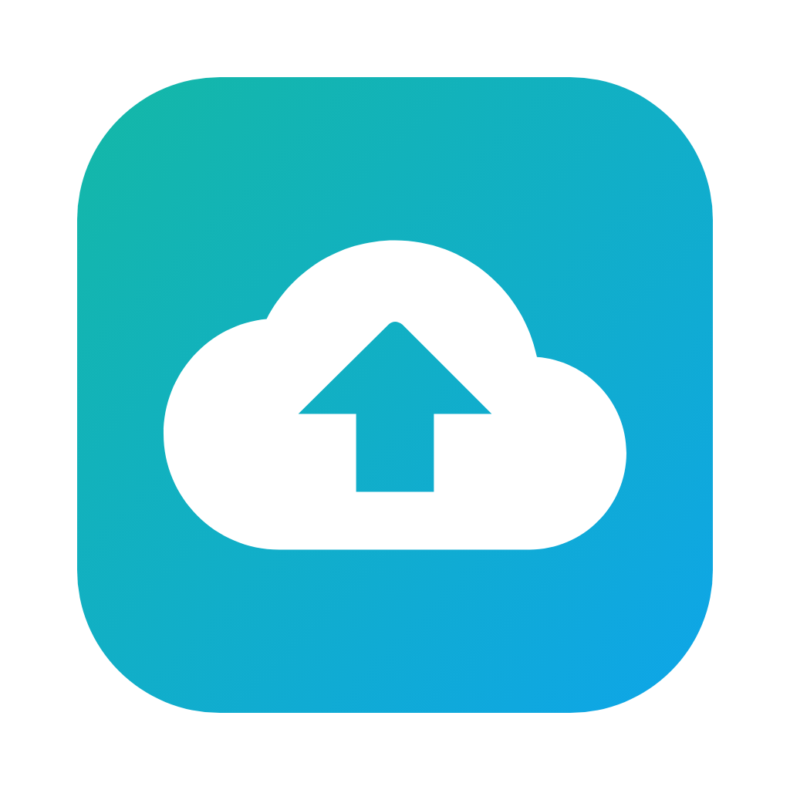
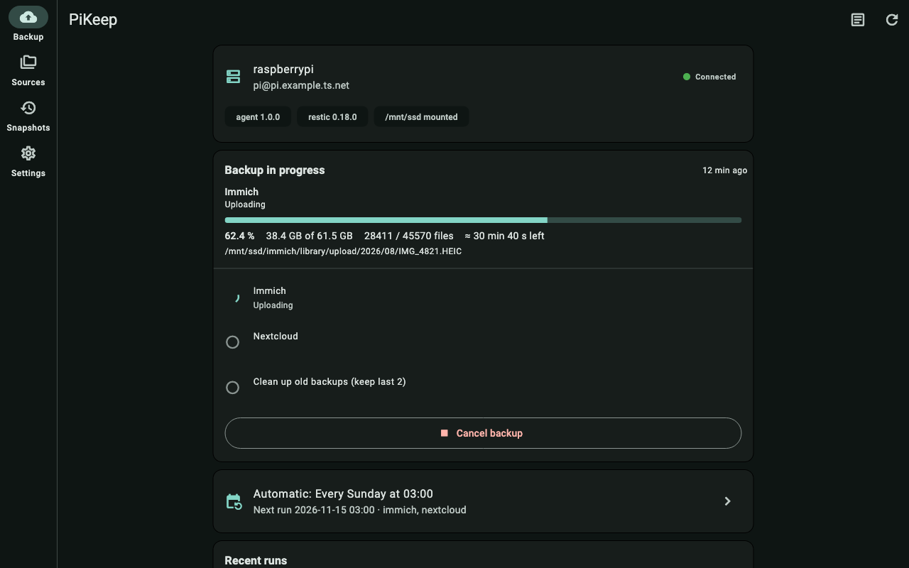

<p align="center"></p>

# PiKeep

**Encrypted Raspberry Pi backups, run from your phone or desktop.**

PiKeep is a remote control for the backup job on your Raspberry Pi. Choose what
to back up, start it or put it on a schedule, and watch encrypted
[restic](https://restic.net) snapshots of your photos, files and databases
upload to OneDrive through [rclone](https://rclone.org). The app never moves
data itself: it tells the Pi what to do over SSH, and the Pi does the work — so
a backup keeps running when the app is closed.

Website and downloads: **https://abhishekkulhary.github.io/pikeep/**

<p align="center"></p>

## Features

- **Start, cancel, watch** — live progress (percent, bytes, files, time left,
  current file), per-step results and the full job log.
- **Automatic backups** — daily, every second day, weekly or monthly, run by a
  systemd timer on the Pi. Missed runs (Pi switched off) happen at next boot.
- **Keep the last N** — old snapshots are pruned after each backup (2 per
  source by default); only sources that succeeded in that run are touched.
- **Immich and Nextcloud built in** — PostgreSQL/MariaDB dumps before the
  upload, Nextcloud maintenance mode during it (always switched back off).
- **Any folder** — add sources with a folder browser that shows the Pi's disk.
- **Dry runs, verification and a snapshot list** per source.
- **Careful by default** — SSH host keys are pinned on first use, secrets live
  in the platform keychain, no account, no telemetry.

## How it fits together

```
PiKeep app ──SSH──▶ sudo -n /usr/local/bin/pi-backup-agent <command>   (JSON out, job JSON in)
                         └─ start ─▶ systemd-run pi-backup-job ─▶ restic backup / forget --prune / check
                         └─ schedule ─▶ pi-backup-schedule.timer ─▶ same job, unattended
```

| Part | Where |
|---|---|
| Flutter app (Android, iOS, macOS, Windows, Linux) | `lib/` |
| Pi agent (bash + jq), installer, config | `pi/` |
| Website (GitHub Pages) | `site/` |
| Release and Pages workflows | `.github/workflows/` |

The agent runs as root with input from the network, so it validates everything:
paths must resolve (symlinks included) inside `ALLOWED_ROOTS`; ids, remotes,
repository paths, container names and schedule values must match strict
patterns; nothing user-supplied ever reaches a shell. The sudoers rule allows
that one binary only.

## Set up the Pi

Needs Raspberry Pi OS / Debian, `restic`, `jq` and a **current** rclone — Debian's
rclone package is too old for OneDrive uploads.

```bash
sudo apt install -y restic jq
sudo -v ; curl https://rclone.org/install.sh | sudo bash
sudo rclone config                       # create a remote named "onedrive"
sudo sh -c 'umask 077; openssl rand -base64 32 > /root/.restic-pass'
sudo cat /root/.restic-pass              # save this in your password manager
```

Then install the agent from the latest release:

```bash
curl -LO https://github.com/abhishekkulhary/pikeep/releases/latest/download/PiKeep-pi-agent.tar.gz
tar xzf PiKeep-pi-agent.tar.gz && cd pikeep-pi-agent
sudo ./install.sh "$USER"
```

`install.sh` installs `/usr/local/bin/pi-backup-agent`, `/etc/pi-backup/agent.conf`
(kept if present) and `/etc/sudoers.d/pi-backup-agent`, and finishes with a self-test.
Edit `agent.conf` to change the folders the app may back up (`/mnt/ssd` by default).

In the app: **Settings → Save & test connection**, pick the `onedrive` remote,
**Initialize repository** once, then start with a dry run.

## Develop

```bash
bash tool/setup_platforms.sh      # generates the Xcode projects (not committed)
flutter pub get
flutter analyze && flutter test -x golden
shellcheck pi/pi-backup-agent pi/install.sh
```

The Xcode bundles are generated rather than committed because this project
lives in a synced folder whose client mangles them. Website screenshots are
golden tests rendered with demo data:

```bash
flutter test test/screenshots --update-goldens && ./tool/sync_site_images.sh
flutter test test/tools/generate_icon_test.dart --update-goldens && dart run flutter_launcher_icons
```

## Releasing

Bump `version:` in `pubspec.yaml`, then tag:

```bash
git tag v1.0.0 && git push --tags
```

The release workflow builds the macOS DMG, Windows zip, Linux AppImage, Android
APK, an unsigned iOS build and the Pi agent tarball, and publishes them under
fixed names that the website's download buttons use. The macOS and Windows
builds are unsigned; the website explains how to open them.

GitHub Pages needs one manual step: **Settings → Pages → Source: GitHub Actions**.

## License

Apache-2.0 — see [LICENSE](LICENSE).
